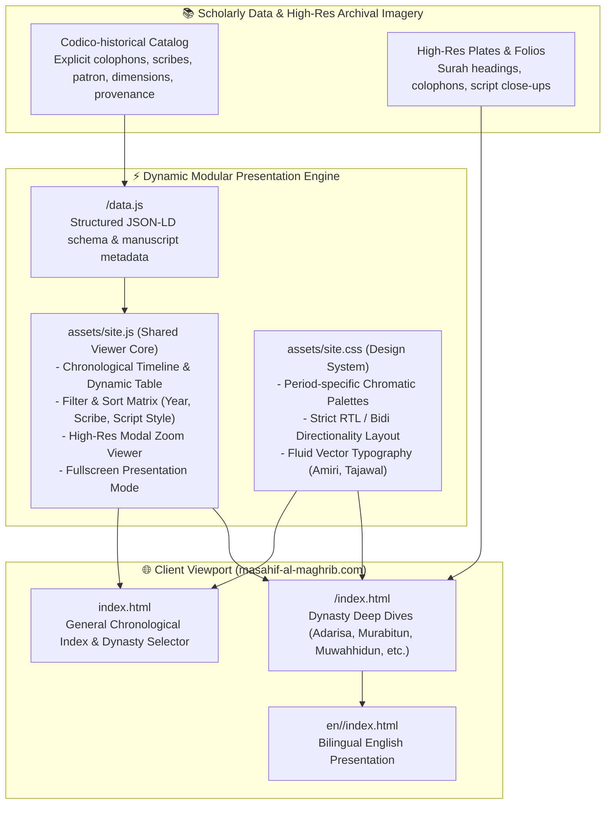
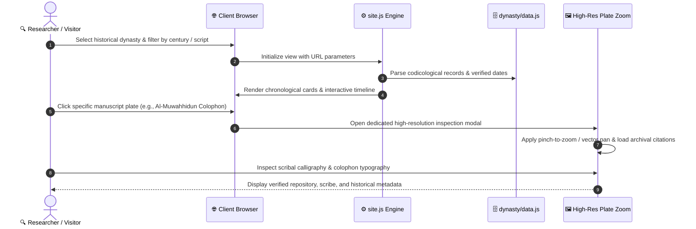

# مصاحف المغرب (Masahif al-Maghrib)

**دليل مصوَّر تفاعلي للمصاحف المخطوطة المؤرَّخة في عصور المغرب · من الأدارسة إلى العلويين**

[**🌐 زيارة المنصة المباشرة (masahif-al-maghrib.com)**](https://masahif-al-maghrib.com/) · [**English Overview**](#english-summary--architecture)

---

دليل بصري وتاريخي موثق للمصاحف المؤرَّخة المعروفة الصاحب في عصور المغرب الحضارية السبعة، يجمع بين التحقيق المخطوطاتي الدقيق، والتحليل الخطي المقارن، والعرض البصري الرقمي فائق الدقة.

### صفحات العصور الحضارية

| العصر الحضاري | الفترة والتاريخ | الرابط المباشر |
|---|---|---|
| **الأدارسة** | 172هـ – 375هـ | [masahif-al-maghrib.com/adarisa/](https://masahif-al-maghrib.com/adarisa/) |
| **المرابطون** | 448هـ – 541هـ | [masahif-al-maghrib.com/murabitun/](https://masahif-al-maghrib.com/murabitun/) |
| **الموحدون** | 515هـ – 668هـ | [masahif-al-maghrib.com/muwahhidun/](https://masahif-al-maghrib.com/muwahhidun/) |
| **بنو مرين** | 642هـ – 869هـ | [masahif-al-maghrib.com/marini/](https://masahif-al-maghrib.com/marini/) |
| **الوطاسيون** | 876هـ – 961هـ | [masahif-al-maghrib.com/wattasi/](https://masahif-al-maghrib.com/wattasi/) |
| **السعديون** | 915هـ – 1069هـ | [masahif-al-maghrib.com/saadi/](https://masahif-al-maghrib.com/saadi/) |
| **العلويون** | 1076هـ – إلى العصر الحاضر | [masahif-al-maghrib.com/alawi/](https://masahif-al-maghrib.com/alawi/) |

---

## 📜 شرط الدليل وضوابط التوثيق

تدخل القائمة الأولى في كل عصر المصاحفُ التي اجتمع فيها شرطان تاريخيان حاسمان:
1. **تاريخ نسخ صريح**: مقيد ومثبت بنص الخاتمة الأصلية أو نص الوقفية المقترنة بزمن النسخ.
2. **اسم صاحب المصحف**: أي ناسخه أو مَن كُتب له المصحف، مع اشتراط نسخه داخل بلاد تلك الدولة في المغرب الأقصى.

وفي كل صفحة قسمان تكميليان:
- **مصاحف ذكرتها المصادر وضاعت أصولها**.
- **مصاحف مشهورة تقف على حافة الشرط** مع بيان علة التحفظ.

---

## 🏗️ Architecture & Engineering System

---

## 🔄 Sequence Diagram: High-Fidelity Plate Exploration Lifecycle

---

## 🎬 Bilingual Promo Video Production & Multi-Agent Media Pipeline

As part of the platform's public launch, an automated **multi-agent media and video production pipeline** was orchestrated using **Claude Code** and generative media tools:

- **Bilingual Narrative Scripting**: Authored high-fidelity Arabic narration and synchronized English subtitles capturing the artistic evolution of the Moroccan Maghrebi scripts (Mabsut, Mujawhar, Thuluth Maghrebi).
- **Cinematic Pacing & Motion Graphics**: Orchestrated keyframe timing, fluid camera transitions across manuscript plates, and ambient acoustic mastering.
- **Multi-Format Export**: Rendered 16:9 widescreen master editions and 9:16 vertical video reels for cross-platform cultural dissemination.

---

## 📸 Visual Plates, Reader Interface & Video Snapshot Showcase

> [!NOTE]
> Below are placeholder cards for high-resolution manuscript plates, the interactive reader UI, and promotional video releases.

| 📜 Historical Manuscript Plate Viewer | ⏳ Interactive Chronological Timeline |
|:---:|:---:|
|    *Deep-zoom inspection of historical scribal colophons* |    *Cross-dynasty temporal sorting & verified dating* |

 

| 🎬 Bilingual Promo Video Cut (Arabic / English) | 📱 Responsive Mobile Typography & Layout |
|:---:|:---:|
|    *Cinematic multi-agent video release showcasing manuscript art* |    *100/100 PageSpeed with bespoke Maghrebi typographic stack* |

---

## ⚖️ حقوق الصور والمصادر

أكثر الصور من مكتبات ومتاحف عالمية تتيحها ملكاً عاماً أو بترخيص ثقافي مفتوح (المكتبة الوطنية للمملكة المغربية، الخزانة الحسنية بالرباط، خزانة القرويين بفاس، ومكتبات باريس وإسكوريال وإسطنبول). وتُذكر إحالة ومصدر كل مصحف تحته نصاً وتفصيلاً.

---

**إعداد وتحقيق:** إبراهيم حسني إدريسي، خطاط وباحث في الخطوط المغربية والمصاحف من فاس · [واتساب](https://wa.me/212681769161)  
**التصميم والهندسة الرقمية:** [خالد بنجلون](https://benjelloun.dev) (Khalid Benjelloun)

